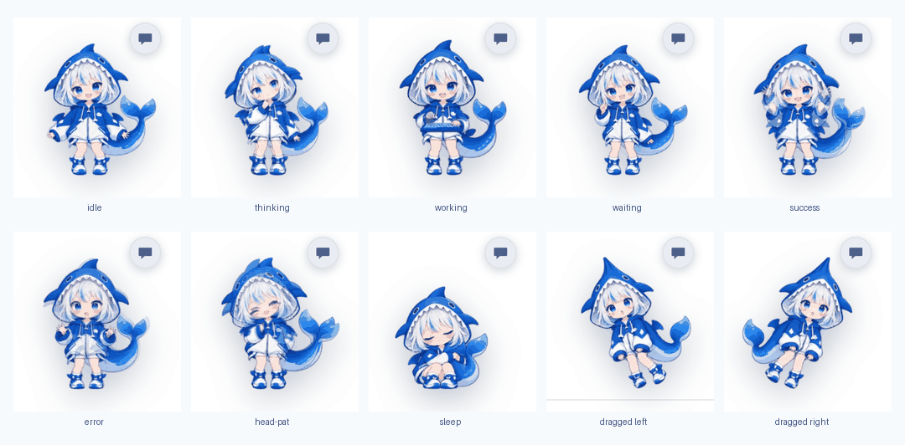
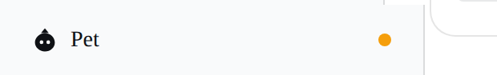
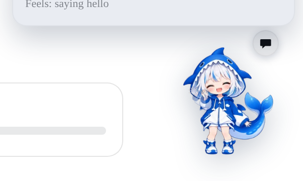
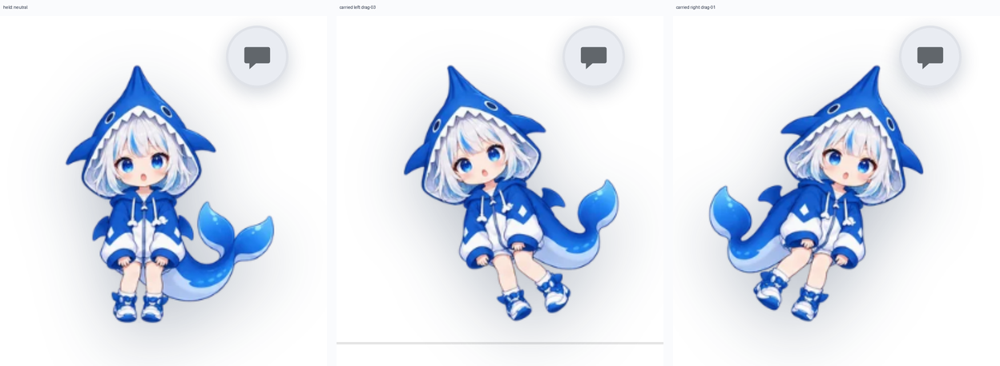
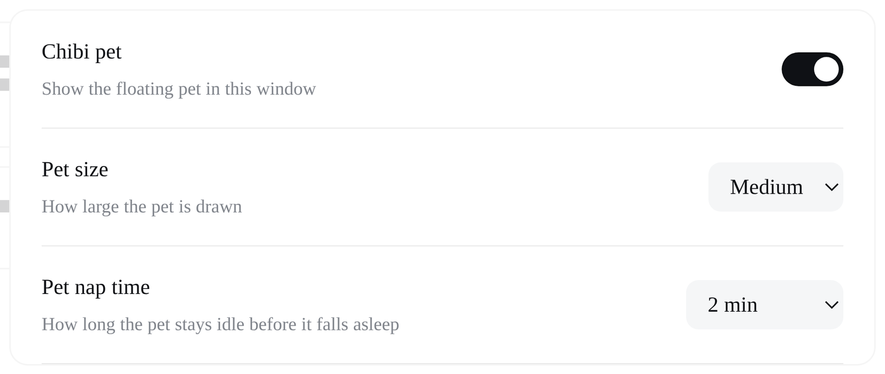

# dsh-chibi-pet

[](https://github.com/Cheva1234/dsh-chibi-pet/actions/workflows/ci.yml)
[](https://www.npmjs.com/package/dsh-chibi-pet)
[](LICENSE)

A chibi pet for the DeepSeek Harness Web GUI. It floats over the frame, belongs
to **one session**, and shows what that session is actually doing — thinking,
running tools, waiting for an approval, finishing, failing, dozing off. You can
drag it anywhere, pat its head, and **type a request straight into it**: whatever
you write is queued into its session.



## Install

The plugin is a Harness **bundle**. Pick whichever route you like — all three end
up in the same place.

**From the GUI (easiest).** Open **Settings → Plugins**, paste one of these into
the install field, and confirm:

```
dsh-chibi-pet                                    # after it is on npm
github:Cheva1234/dsh-chibi-pet                   # straight from this repo
https://github.com/Cheva1234/dsh-chibi-pet/releases/download/v1.0.0/dsh-chibi-pet-1.0.0.tgz
```

**From the Plugin Manager tool** (used by an agent, or by you):

```jsonc
{ "action": "install_bundle", "target": "github:Cheva1234/dsh-chibi-pet" }
```

**From a clone**, for development:

```bash
git clone https://github.com/Cheva1234/dsh-chibi-pet
# then point the Plugin Manager at that absolute directory
```

There is no build step at install time: the browser bundle is committed, so the
installer only fetches files. Disable or uninstall it from the same Plugins page
whenever you like.

## Using it

| Interaction | What happens |
|---|---|
| click the pet | head pat — refused while an approval or a failure is on screen |
| drag the pet | it moves and leans further the further you carry it |
| speech-bubble button | opens the input: type a request, **Enter** sends it to the pet's session |
| right-click | sends the pet back to its corner |
| sidebar switch, Settings row, or <kbd>Ctrl/⌘</kbd>+<kbd>Shift</kbd>+<kbd>.</kbd> | show or hide the pet |



Position is remembered across reloads, and the pet only captures the pointer
inside its own small box — everything under it stays clickable.

### One session per pet

The pet attaches to a single session and reacts to nothing else. The first
conversation it sees becomes its session; after that, other sessions never move
it. The chat input's header names the session it serves, and if that session
disappears the pet says so and offers to follow the conversation you are looking
at.

Turn on **follow mode** (the switch inside the chat input) and the pet re-homes
onto whichever conversation you are viewing instead of staying put.

### Talking to it



**Enter** queues your line into the bound session exactly as the composer would
send it — it can never interrupt a running turn. **Esc** or a click outside
closes the input. A rejected prompt is reported in the input instead of failing
silently.

### Carrying it

Holding the pet hangs it straight down; carrying it leans it into the direction
of travel, further the further it goes. Distances are measured from where you
picked it up, so pausing mid-drag never drops it back upright.



### While you are looking elsewhere

If the bound session finishes a turn, fails, or needs an approval while it is not
the conversation on screen, a small dot appears on the pet and on the sidebar
switch. It clears as soon as you look at that session or open the pet's input.

## Settings



| Setting | Default | What it does |
|---|---|---|
| Chibi pet | on | show or hide the pet in this window |
| Pet size | Medium | Small 84 px / Medium 112 px / Large 140 px wide |
| Pet nap time | 2 min | how long the pet stays idle before it falls asleep; **Never** keeps it awake |
| Follow the conversation I am viewing | off | re-home the pet onto whatever you are viewing |

Preferences live in this browser (`localStorage`), not in the Harness profile, so
they do not travel between browsers or machines.

## What the pet reacts to

| Pose | Trigger | Playback |
|---|---|---|
| `greeting` | once per page load, ~250 ms after mount, only when nothing is running | once |
| `thinking` | session running, assistant text streaming | loop |
| `working` | session running with a live tool call | loop |
| `waiting` | a new pending interaction (approval / question), deduped by its key | once, then holds until answered |
| `success` | a turn that ran > 600 ms ends without a new error | once |
| `error` | a new agent error appears | once |
| `head-pat` | you click the pet, unless an approval or a failure is showing | once |
| `idle` | nothing to report | loop |
| `sleep` | idle for the configured nap time with no work pending | loop |
| `drag` | being carried — two drawings, one per direction | held |

With `prefers-reduced-motion: reduce` the pet shows the first pose of each state
and switches only when the state changes.

The pet is decoration: it never approves, denies, submits or dismisses anything,
and it cannot see or influence tool policy.

## Build it yourself

`client.js` is generated: it is `src/pet-client.js` with the sprite table
inlined. The Harness serves a client plugin as JavaScript only — a plugin package
cannot fetch its own PNGs over HTTP — so the atlases travel inside the bundle as
WebP data URIs.

```bash
python3 tools/build_sprites.py --zip  /path/to/sprite-pack.zip
python3 tools/build_sprites.py --pack /path/to/extracted-pack
```

The layout it expects: `<state>/frames/<state>-NN.png` (six 512×560 RGBA poses
per state) and `<state>/animation.json` (timed sequence and loop policy), for
`idle`, `thinking`, `working`, `waiting`, `success`, `error`, `head-pat`, `drag`,
`sleep`, `greeting`.

Useful flags: `--frame-width 224` for a smaller bundle (display sizes scale
down), `--quality 80` for more compression. The module id in the bundle is taken
from `package.json`, so the two can never drift.

## Tests

```bash
node --check client.js           # the bundle parses as a browser script
node tools/check-bundle.mjs      # module id, atlas count, Loader row
node tools/test-machine.mjs      # 22 behaviour checks, no browser needed
```

`tools/test-machine.mjs` loads the real bundle with a stubbed
`window.__ModuleLoader__` and drives the exported behaviour fold: greeting once,
no greeting over live work, thinking vs working, approval dedupe and hold,
success threshold, error dedupe, head-pat urgency, sleep and wake, no cheer on a
session switch, the three carry levels, and the preference table.

Rendering was verified in headless Chrome against a stand-in shell: every pose,
light and dark, both carry directions, the chat input sending a real prompt, all
three sizes, the sidebar switch, the Settings rows, the attention badge, follow
mode, the keyboard command and `prefers-reduced-motion`.

## Layout

| Path | Role |
|---|---|
| `package.json` | bundle manifest, `dsh.client`, display metadata, icon |
| `cordis.patch.yml` | inserts the `dsh-pet` Loader row |
| `index.js` | Host half — intentionally inert |
| `src/pet-client.js` | client source: state machine, renderer, slots, preferences |
| `client.js` | **generated** bundle served to the browser |
| `tools/build_sprites.py` | sprite pack → atlas table → bundle |
| `tools/check-bundle.mjs` | CI guard for the generated bundle |
| `tools/test-machine.mjs` | behaviour tests |
| `locale/en.json`, `locale/zh.json` | Plugin Manager title and description |
| `docs/` | the images in this README |

## Requirements and limits

- The Harness **Web** GUI. The pet draws into `shell.overlay`,
  `sidebar.footer.action`, `settings.general.item` and `conversation.composer.dock`.
- It floats anywhere **inside the Harness window**. An always-on-top window over
  your OS desktop is not something a web plugin can create.
- Sending work uses the Client `sessions` service and queues into the bound
  session; it never approves anything on your behalf.
- The keyboard command uses one of the few physical combinations the Web
  composition admits; rebind it in **Settings → Shortcuts** if it clashes.

## Licence

Code: [MIT](LICENSE). The sprite artwork is third-party fan art with its own
notice — read [ATTRIBUTION.md](ATTRIBUTION.md) before reusing it.
